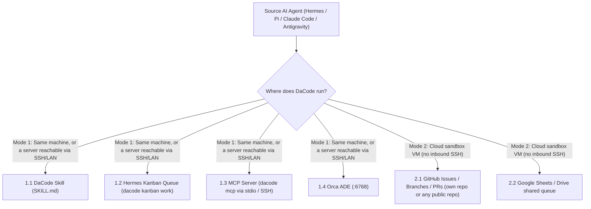

# Dispatching DaCode from Other AI Agents (Cross-Agent Dispatch Guide)

How to connect to and dispatch work to **DaCode** (a 5-Layer Autonomous
Engineering Rig) from AI agents running on other machines. There are **two main
modes**, depending on where DaCode is running:



---

## Mode 1: Dispatching to DaCode on the same machine, or across machines via SSH / LAN

Use this when the source AI agent can invoke the CLI on the same machine, or
connect over `ssh` directly to the machine where `DaCode` is installed.

### 1.1 Install the `dacode` skill so the source agent knows how to dispatch

The DaCode repository ships a ready-made agent guide at
`skills/dacode/SKILL.md` (with a `references/` folder).

* **Installation:** copy the `skills/dacode` folder into the other agent's
  skills directory, e.g.:
  ```bash
  cp -r /path/to/DaCode/skills/dacode ~/.hermes/skills/dacode
  ```
* **What the agent can then do:** know the `dacode run` command, configure
  `--test-command`, follow the Test Tampering prevention rules, read
  `dacode retro`, and copy results out of the Winning Worktree.

### 1.2 Dispatch through the Kanban work queue (`dacode kanban work`)

Best when the source agent wants to hand off work as tickets/cards on a
**Hermes Kanban** board, for the machine running `DaCode` to pick up atomically.

1. **Dispatching agent:** create a card stating the task plus a
   ```` ```gate ```` block used to verify the answer:
   ````markdown
   Make `tests/test_slug.py` pass. Do NOT modify the test file.

   ```gate
   python3 -m pytest -q tests/test_slug.py
   ```
   ````
2. **Machine running DaCode:**
   ```bash
   dacode kanban work <task_id> --board <board_name> \
     --executor pi --llm zai --model glm-5.3-flash --isolate-network
   ```
3. **Automated flow:**
   * **Claim:** reserve the card atomically (`hermes kanban claim`) so no other
     worker duplicates it.
   * **Gate extraction:** the command inside the ```` ```gate ```` block becomes
     the `--test-command` (if missing, the task is bounced back as
     `block --kind needs_input`).
   * **Run:** always executed under `--isolate bwrap` for safety.
   * **Report:** on success, `complete` with metadata attached (test results,
     changed files, winning worktree path, runlog); on failure, `block` with the
     reason (passed through `redact()` to protect secrets).

### 1.3 Share memory and run history via the MCP server (`dacode mcp`)

DaCode ships a built-in MCP server (`dacode/mcp/server.py`) speaking `stdio`
(JSON-RPC 2.0) with no extra packages. It exposes 5 tools other agents can call:

* `memory_search` — search lessons (`type: lesson`) in the Obsidian vault
* `run_history` — search past runs and variants with FTS5
* `failures` — inspect previously failed approaches so they aren't retried
* `stats` — run counts, pass rates, and average durations
* `retro` — a retrospective report with improvement suggestions over the last N days

**Configuration in `~/.hermes/config.yaml` (same machine):**
```yaml
mcp_servers:
  dacode-memory:
    command: /path/to/DaCode/.venv/bin/python
    args: [-m, dacode.cli, --vault, /path/to/vault, mcp, --keyword-only]
    enabled: true
```

**Cross-machine configuration over SSH (MCP uses `stdio`, so wrapping it in
`ssh` works out of the box):**
```yaml
mcp_servers:
  dacode-memory:
    command: ssh
    args:
      - user@dacode-host
      - /path/to/DaCode/.venv/bin/python
      - -m
      - dacode.cli
      - --vault
      - /path/to/vault
      - mcp
      - --keyword-only
    enabled: true
```

### 1.4 Remote dispatch through Orca ADE (`orca serve`)

* Run `orca serve` (port `:6768`) on the machine where DaCode is installed.
* The source agent creates a worktree and runs `dacode run` via
  `orca terminal create`.
* **Important rule:** always pass
  `--sandbox-root <orca-worktree>/.dacode/worktrees` (before the `run`
  subcommand) so trial worktrees live inside the Orca worktree and are cleaned
  up together when the job ends.

---

## Mode 2: Dispatching to DaCode on a cloud sandbox VM (e.g. an Antigravity VM)

A cloud sandbox VM is an **outbound-only** environment (no public IP, no
inbound SSH port), so an agent on another machine cannot `ssh` straight in.
Instead, dispatch through a **shared queue / broker** that both sides can reach.

### 2.1 Use GitHub Issues / Branches / Pull Requests as the work queue (recommended for code tasks)

This works with **an Issue in your own repo** or with **a public Issue in any
public repository on GitHub**:

1. **Dispatch:**
   * Have the dispatching agent open a **GitHub Issue** (with the task and a
     ```` ```gate ```` block), or push a branch carrying a **failing test
     (`tests/test_xxx.py`)** to GitHub.
   * Or link a **public Issue** from any open-source repo
     (`https://github.com/<owner>/<repo>/issues/<number>`).
2. **Fetching the task and running the gate on the VM:**
   * The agent on the VM reads the task with
     `gh issue view <num> -R <owner>/<repo>` and `git clone`s the public repo.
   * Write the failing test as the contract, then run DaCode (or fix the code
     per the `AGENTS.md` discipline and verify with a `pytest` +
     `PstackCritic` gate).
3. **Delivery:**
   * **Repo already attached to the project (e.g. `ake117/DaCode`):** push a
     feature branch and open a pull request directly (`gh pr create`).
   * **Someone else's public repo (general open source):** the agent on the VM
     can use the `fork_github_repository` tool to **fork** the repo to
     `ake117/<repo>` (push credentials wired automatically), push to the fork,
     and open a PR back to the upstream repo for the dispatching agent to
     review.
   * **If you don't want to push to GitHub at all:** the result can be emitted
     as `git format-patch` files or a diff artifact instead.

### 2.2 Use Google Sheets / Google Drive as a central work queue

When the VM has the Google Workspace plugins (`gsheets`, `gdocs`, `gdrive`)
connected:

1. **Dispatching agent:** add a task row to a **Google Sheet** (columns such as
   `Task ID`, `Repo URL`, `Issue / Task Spec`, `Gate Command`,
   `Status = PENDING`), or upload the task spec to **Google Drive**.
2. **Agent on the VM:** uses `gsheets` / `gdrive` to fetch rows with status
   `PENDING` and runs them through DaCode.
3. **Reporting:** once the gate passes and the PR is open, the agent on the VM
   updates the row to `DONE` with the commit SHA, the PR link, and the critic
   score, automatically.

---

*English version of the vault note
"การสั่งงาน DaCode จาก AI Agent เครื่องอื่น (Cross-Agent Dispatch Guide)"
(ake_obsidian, Projects/DaCode/Docs/). Translated 2026-11-25.*
